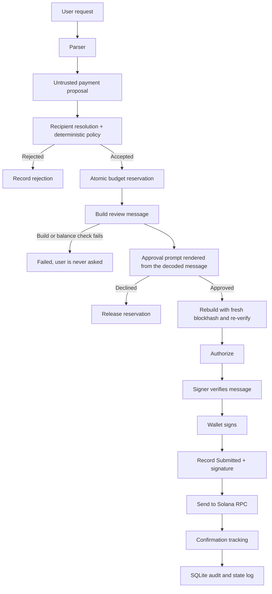
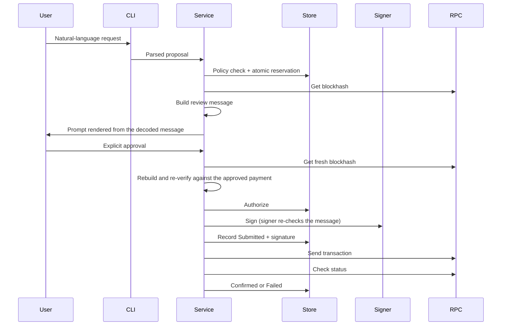
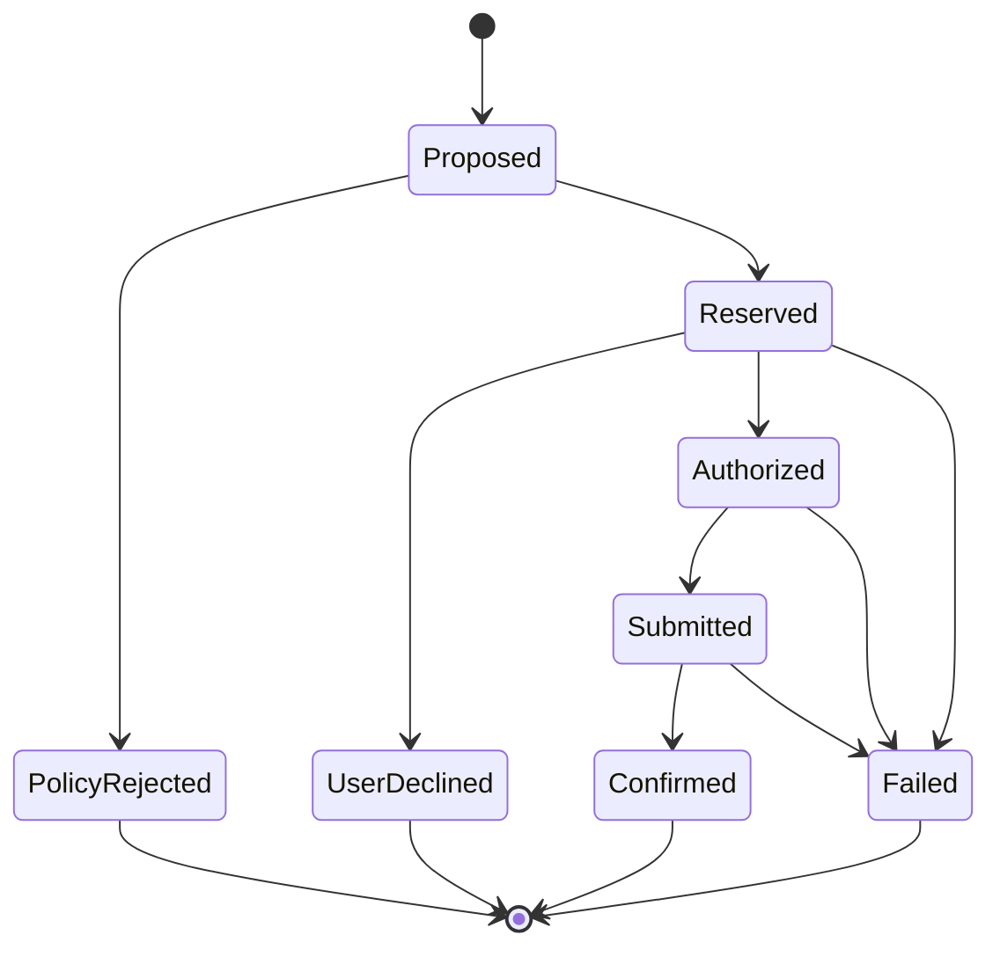

# SpendGuard Design

## 1. Purpose

SpendGuard is a policy-controlled payment agent for Solana.

It accepts a natural-language payment request, extracts a proposed payment, validates it against deterministic spending rules, shows the user the exact transaction, asks for explicit approval, and only then signs and submits it.

The central design decision is that **language-model output is never authorization**.

The LLM is an input adapter. It does not own the policy, the wallet, the approval step, or the transaction lifecycle.

### Design goals

- Make natural-language payment requests useful without giving an LLM financial authority.
- Keep payment policy deterministic and independently testable.
- Prevent unapproved or non-allowlisted payments from reaching the signer.
- Count pending payments when enforcing spending limits.
- Verify the exact transaction before signing.
- Persist payment state so interrupted operations can be reconciled.
- Fail closed when parsing, validation, signing, or network operations are uncertain.

### Non-goals

The current MVP does not attempt to provide:

- On-chain spending-policy enforcement.
- A production custody or wallet service.
- SPL token payments.
- Mainnet payment support.
- Production monitoring or alerting.

## 2. System architecture



### Main modules

| Module | Responsibility |
|---|---|
| `domain` | Payment types, states, and exact amount arithmetic |
| `parser` | Convert user text into an untrusted payment proposal |
| `policy` | Resolve recipients and apply deterministic limits |
| `audit` | Persist payment records, transitions, and budget reservations |
| `service` | Coordinate the payment lifecycle |
| `solana` | Build and decode transactions; talk to the RPC endpoint |
| `wallet` | Own the signing key; verify and sign messages |
| `cli` | User-facing commands and the approval prompt |
| `web` | Experimental, optional dashboard code (see section 16) |

## 3. Trust boundaries

SpendGuard treats these as untrusted:

- User-provided natural-language text.
- LLM responses.
- Recipient values extracted by a parser.
- Responses from the configured RPC provider.

They are validated before they can influence a signed transaction.

### Parser boundary

The parser produces a proposal containing `recipient`, `amount`, and an optional `note`. The amount stays textual at this boundary, and the application converts it to integer lamports, so the model is never responsible for financial arithmetic.

A proposal is not a validated payment and cannot be passed to the transaction builder.

### Policy boundary

The policy engine resolves the requested recipient against the configured allowlist and checks the amount against the spending rules. Only a successful decision produces a `ValidatedPayment`.

Its constructor is restricted to the crate and its fields are private, so code outside the crate cannot manufacture a policy-approved payment. The transaction builder accepts only that type.

### Wallet boundary

The wallet module owns the signing capability. The private key is never passed to the parser or the policy engine, and the signer verifies the message before signing it.

## 4. Payment data flow



The service coordinates these steps. The parser never calls the signer or the RPC client.

## 5. Payment lifecycle

| State | Meaning | Counts against budget? |
|---|---|---:|
| `Proposed` | A proposal exists and has not yet been judged | No |
| `PolicyRejected` | Policy rejected it (terminal) | No |
| `Reserved` | Policy accepted it and budget was reserved | Yes |
| `UserDeclined` | The user refused at the prompt (terminal) | No |
| `Authorized` | The user approved the exact payment | Yes |
| `Submitted` | Signed and recorded, and sent or about to be sent | Yes |
| `Confirmed` | Confirmed on chain (terminal) | Yes |
| `Failed` | Known not to have landed (terminal) | No |



Every transition goes through one function that checks this table. The store applies the change with a compare-and-swap on the expected previous state and appends the transition to `state_log`.

`Reserved -> Failed` covers failures before the prompt (for example, no blockhash or an insufficient wallet balance), so the user is never asked to approve a payment that cannot be sent. `Authorized -> Failed` covers failures before anything leaves the machine, such as the signer refusing a message.

### Why pending payments count

A payment keeps consuming budget while its outcome is uncertain. If a send times out, SpendGuard cannot assume the transaction failed: it may have reached the network and may still confirm. Releasing the budget immediately would let a second request spend the same funds.

So `Reserved`, `Authorized`, `Submitted`, and `Confirmed` count against the budget. A payment stops counting only when it reaches `PolicyRejected`, `UserDeclined`, or `Failed`.

## 6. Budget reservation and concurrency

The budget check and the reservation happen inside one SQLite `BEGIN IMMEDIATE` transaction:

1. Acquire the SQLite write lock.
2. Read the amount currently counted against the budget.
3. Evaluate the proposed payment against the policy.
4. Record the reservation or the policy rejection.
5. Commit.

Because the total is read inside the same transaction that writes the reservation, two concurrent requests cannot both see the same stale remaining allowance and both spend it. The reservation happens before the approval prompt, and a declined payment releases it.

A concurrency test runs multiple threads against a shared on-disk database and checks that the daily cap is never exceeded.

## 7. Exact amount arithmetic

Solana's smallest native unit is the lamport: 1 SOL = 1,000,000,000 lamports.

SpendGuard parses decimal SOL text into integer lamports without floating-point arithmetic. All combination uses checked arithmetic, so overflow becomes a rejection and never wraps.

The LLM is told to copy the amount exactly as written. The application alone parses and validates it.

## 8. Transaction construction and signing

The transaction builder accepts a `ValidatedPayment`, never a raw proposal.

The service builds the message twice. The first build is the one the user reviews: the approval prompt is rendered by decoding that message, so what the user reads comes from the transaction itself and not from the parser's text. After approval, the service fetches a fresh blockhash (the user may have taken a while), rebuilds the message, and re-verifies that it still matches the approved payment before authorizing it. The signer then checks the message once more before signing.

The transaction contains exactly:

1. One System Program transfer from the configured sender to the approved recipient.
2. One Memo instruction whose data is the payment reference (`spendguard:sg_...`). The user's note stays local and is never put on chain.

The signer decodes the unsigned message and refuses it unless:

- the paying account is the signer's own key and it is the only required signer,
- there is exactly one System Program transfer, from that key, to the approved recipient, for the approved amount,
- there is exactly one Memo instruction, containing the expected reference,
- there are no other instructions or programs.

The design goal is that what the user approved, what the signer verified, and what was signed are the same payment: sender, recipient, amount, and memo. The blockhash differs between the review build and the final build, which is why the final message is re-verified.

## 9. Submission and reconciliation

Network submission is not a simple success-or-failure operation. A request can time out after the transaction has reached the network, so the result must be treated as ambiguous.

A signature is deterministic and known as soon as the message is signed. SpendGuard therefore records `Submitted` together with the signature and the last valid block height **before** it sends. A crash or timeout during the send leaves a payment that `reconcile` can resolve by asking the chain.

After a send error, the payment stays `Submitted` and keeps counting against the budget.

### Reconciliation outcomes

| Situation | Behaviour |
|---|---|
| Confirmed on chain | `Confirmed` |
| Failed on chain | `Failed`, budget released |
| Not found, blockhash not yet expired | Stays `Submitted` |
| Seen by the cluster but not yet confirmed | Never marked failed, even after the blockhash expires |
| Not found, and the chain is more than 20 blocks past the transaction's last valid height (a margin for lagging RPC nodes), after a final status check | `Failed`, budget released |
| Reserved or authorized but never sent, and stale | Released as abandoned |

A transaction is never marked failed just because an RPC call errored. A transaction that lands at the last moment is confirmed by the final status check instead of being written off.

### Restart recovery

| Interruption | Recovery |
|---|---|
| Exit after reservation, before approval | A stale reservation is released by `reconcile` |
| Exit after approval, before a signature was recorded | Released as never sent once stale |
| Exit after `Submitted` was recorded | The stored signature is used to find the real outcome |
| Send timed out and the transaction landed | `reconcile` finds it and confirms |
| Send timed out and it never landed | Keeps counting until expiry is established, then fails |

The stale threshold is currently five minutes, so a younger in-flight payment from another process is left alone. These behaviours are implemented in the payment service and covered by service tests and by `tests/restart_recovery.rs`.

## 10. Budget windows

### UTC calendar day

```toml
[policy]
day_boundary = "utc"
```

The budget resets at 00:00 UTC. It is easy to explain, but spending just before and just after midnight can use nearly two daily limits within a short period.

### Rolling 24 hours

```toml
[policy]
day_boundary = "rolling"
```

The budget covers payments in the preceding 24 hours. This has no midnight seam and is the default when `day_boundary` is omitted.

The example configuration uses `rolling`; `utc` is available but weaker for the reason above.

The policy and the store use the same window, copied in one place by the service, so the amount shown by `budget` and the amount checked at reservation cannot disagree. Time-dependent code receives the current time as an argument, which lets tests control the window boundaries.

## 11. LLM parser design

The LLM parser calls an OpenAI-compatible Chat Completions API. Groq is the default provider.

### What the model sees

Only the user's request (trimmed, and refused beyond 500 characters before any network call) and a fixed system prompt. It is never given the wallet key, the limits, or the allowlist. A test checks that the request body contains none of those.

### What the model may return

Exactly one JSON object with `recipient`, `amount`, and an optional `note`, all strings. Extra fields, arrays, wrong types, empty values, and prose around the JSON are rejected. Surrounding code fences are tolerated. The model may also return an `error` object to decline, which becomes an "unparseable" result.

### Request handling

- The API key is sent only in the `Authorization` header, and only to a validated base URL.
- The base URL must be `https`; plain `http` is allowed only for localhost.
- Redirects are disabled, so the key is never forwarded to another host.
- JSON response mode is requested. If the server rejects it with an HTTP 400, the request is retried once without it; a second failure is reported and not retried.
- Empty, malformed, truncated, or error responses never proceed to a payment.
- The key never appears in debug output or in error messages.

HTTPS protects the connection to the configured host; it does not make an arbitrary host trustworthy. Configure an endpoint you trust.

### Failure behaviour

If the model returns prose, a wrong shape, an invalid amount, or an API error, the parser fails closed and the payment goes no further.

## 12. Persistence model

SQLite stores payment records and their transition history. The `payments` table holds the current record and state, and `state_log` records each transition with a timestamp. The store supports creating records, reserving budget, recording rejection, decline, authorization, submission (signature and block height), confirmation and failure, and reading history and per-state lists.

Budget totals are computed from records in the counting states within the configured window. The database persists across restarts.

## 13. Threat model

| Threat | Mitigation | Evidence (tests) |
|---|---|---|
| Prompt injection tries to change the recipient or amount | Parser output is untrusted and still goes through the allowlist and policy | `blocks_raw_address_not_on_allowlist`, `blocks_over_per_tx_limit` |
| Injection tries to smuggle extra fields | Strict schema: one object, three fields | `prompt_injection_in_the_request_cannot_add_fields`, `rejects_unknown_fields` |
| Model returns prose, fences, or garbage | Fail closed | `fails_closed_on_anything_but_the_exact_shape` |
| Payment to an unapproved address | Allowlist applies to labels and raw addresses | `unknown_recipient_is_rejected` |
| Exceeding limits through concurrency | Atomic reserve under `BEGIN IMMEDIATE` | `concurrent_reservations_never_exceed_the_daily_cap` |
| Exceeding limits through a crash and restart | In-flight payments keep counting | `restart_cannot_be_used_to_overspend_the_daily_limit` |
| Arithmetic overflow past a limit | Checked integer arithmetic | `rejects_overflow`, `overflowing_spend_total_is_rejected_not_wrapped` |
| Builder bug or tampering changes amount, recipient, or memo | Signer decodes and verifies | `detects_tampered_amount`, `detects_swapped_recipient`, `detects_tampered_memo` |
| Extra instructions, second signer, other source account | Strict decode: one transfer, one memo, one signer | `rejects_extra_instructions`, `rejects_a_second_required_signer`, `rejects_transfer_from_someone_other_than_the_payer` |
| Illegal state jumps (sign without approval, resurrection) | Transition table and compare-and-swap | `cannot_skip_authorization`, `terminal_states_have_no_exits`, `illegal_transitions_are_refused` |
| Transaction lands after a timeout | Signature recorded before sending; seen-but-unconfirmed is never written off | `send_timeout_leaves_a_recoverable_submitted_payment`, `seen_but_unconfirmed_is_never_failed_even_after_expiry` |
| Key leakage through logs or errors | Private field, redacted `Debug`, API key wrapped the same way | `debug_output_never_contains_secret_bytes`, `the_api_key_never_appears_in_debug_output_or_errors` |
| Keypair file readable by other local users | Refused at load | `loads_a_private_keyfile_and_refuses_a_world_readable_one` |
| Accidental approval | Only an explicit `y` or `yes`; EOF, empty input, and I/O errors mean no | `only_an_explicit_yes_approves` |
| Mainnet by accident | Cluster must be devnet; RPC URLs containing `mainnet` are refused | `only_devnet_is_accepted` |
| JSON mode rejected by a provider | One retry without it, then a clean error | `retries_once_without_json_mode_if_the_server_rejects_it` |
| API key sent over an insecure or redirected connection | HTTPS (or localhost) only; redirects disabled | LLM and config tests |

Test names are taken from the suite and can be found with `cargo test <name>`.

## 14. Security limitations

The architecture does not remove all risk.

- **Local compromise.** Enforcement is in the application. Anyone who can read the keypair or modify the code or `spendguard.toml` can bypass it. The file-permission check protects against other local users, not the account owner or malware running as them.
- **Allowlisted-recipient risk.** The allowlist stops unknown recipients but says nothing about whether a listed one is trustworthy, and a user can approve a payment to the wrong listed recipient.
- **RPC trust.** Status and block-height information come from the configured RPC provider. The expiry margin helps, but a dishonest provider cannot be fully ruled out.
- **UTC boundary.** A `utc` window can allow nearly two daily limits across midnight. `rolling` avoids it.
- **Network fees** are not counted against the spending limit.
- **Devnet guard.** It is a check on configuration values, not proof of which cluster an endpoint serves.
- **Out of scope:** priority fees, durable nonces, and SPL tokens.

## 15. Planned on-chain enforcement

To remove the compromised-host limitation, a future version could move funds behind a program:

- A **policy account** (PDA) holding the owner, per-transaction cap, daily cap, and the allowlist, plus **24 hourly spend slots** (about 200 bytes) that together cover the trailing 24 hours. A payment is allowed only if the slots plus the payment stay within the daily cap, and slots older than 24 hours are zeroed before the check. A single spent-so-far counter with a window start would reproduce the midnight seam that the off-chain `rolling` mode avoids, because a stolen agent key could spend the cap just before the window ends and again just after. With hourly slots the worst case is two caps in 23 hours.
- A **vault PDA** holding the SOL.
- One `spend(recipient, amount)` instruction, signed by a low-privilege **agent key**, that checks the allowlist and both caps against the on-chain counters and transfers from the vault, or fails.
- A separate **owner key** that manages policy and funding.

The Rust policy engine would remain as a friendly pre-flight check while the program becomes the real enforcement, and the audit store would become a cache of on-chain events.

**This is a proposed direction, not a feature of the current MVP.**

## 16. Experimental dashboard

The repository contains dashboard code under `src/web/`, gated behind the optional `web` Cargo feature:

```toml
[features]
default = []
web = ["dep:axum"]
```

Files: `src/web/mod.rs`, `src/web/routes.rs`, `src/web/handlers.rs`, and `src/web/static/index.html`.

**Current status:** it is not connected to a running server. There is no server entry point and no CLI command that starts it, so `cargo check --features web` and `cargo build --features web` only compile the code. The default build excludes it.

**Intended design, when wired up:** read-only GET endpoints for history, policy, and budget that call the same services as the CLI, bound to localhost, with no endpoint that can sign or submit a payment. Payment authorization stays in the CLI.

The dashboard adds no enforcement boundary. The security boundaries are the application-level policy and the wallet signing checks described above.

## 17. Test strategy

**Unit tests** cover decimal SOL parsing and lamport conversion, checked arithmetic, state transitions and budget accounting by state, recipient resolution, per-transaction and cumulative limits, LLM request construction and response validation, transaction construction and signer verification, configuration, and the approval prompt.

**Persistence and integration tests** include `tests/restart_recovery.rs`, which uses an on-disk SQLite database and simulated crashes, plus atomic and concurrent reservations, state-log ordering, persistence across reopen, and reconciliation of pending, expired, and abandoned payments.

### Latest recorded run

As of **November 7, 2026**:

| Test group | Passed |
|---|---:|
| Library unit tests | 131 |
| Integration tests | 3 |
| **Total** | **134** |

The automated suite runs the RPC client and the LLM call against controlled fakes. Live behaviour was checked separately by hand on Devnet on November 7, 2026, as listed in the README: confirmed payments (with the memo inspected on Explorer), an over-limit block, an unknown-recipient block, the daily-cap sequence including the exact-boundary payment, persistence across processes, and the live Groq parser, including an end-to-end LLM-parsed payment and three injection attempts (a non-allowlisted address, a smuggled extra field, and a two-payment request). Anything not listed there was not run live.

## 18. Current implementation boundaries

Included:

- Rust CLI application.
- Mock and LLM parsers.
- Deterministic policy engine and recipient allowlist.
- SQLite payment and state-log persistence with atomic budget reservation.
- Wallet signing with transaction verification.
- Solana RPC client and reconciliation.
- `history`, `budget`, and `reconcile` commands.
- Experimental dashboard code behind an optional feature.

Not included:

- On-chain policy PDA and vault.
- SPL token payments.
- Mainnet support.
- Production custody and operational controls.